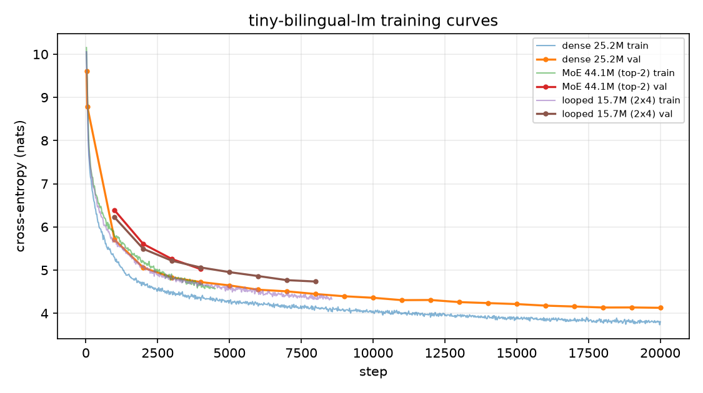

# 08 — Results

All numbers below come from `eval/results/*.json` and `checkpoints/*/metrics.jsonl`
on the RTX 4050 Laptop (6 GB). Validation is 4 M held-out tokens, 64 deterministic
crops; BPB uses 4.382 bytes/token.

## Dense 25.2 M — 20 k steps / 492 M tokens

| metric | value |
|---|---|
| params | 25,172,352 (12.59 M non-embedding) |
| tokens seen | 492 M (19.5 tokens/param) |
| final train loss | 3.81 |
| val loss (nats) | 4.098 |
| perplexity | 60.2 |
| bits per byte | 1.349 |
| wall-clock | 6.6 h |
| peak VRAM | ~5.8 GB |

## MoE 44.1 M (4 experts, top-2)

| metric | value |
|---|---|
| params | 44,059,008 (≈29.9 M active) |
| tokens seen | 55 M (4 500 steps; best ckpt at 4 000 = 49 M) |
| val loss | 5.069 |
| bits per byte | 1.669 |
| throughput | 6–10 k tokens/s |
| note | **at equal tokens the dense model is equally good**: dense at 2 000 steps (49 M tokens) has val 5.056 vs MoE 5.069 at the same 49 M tokens, while MoE costs ~2× compute and 1.75× parameters. With 4 experts, 49 M tokens is far too little routing data — this is the expected "MoE needs much more tokens" result, not a bug. |

## Looped 15.7 M (2 unique blocks × 4 loops)

| metric | value |
|---|---|
| params | 15,730,560 |
| effective depth | 8 |
| tokens seen | 131 M (8 000 steps) |
| val loss | 4.763 |
| bits per byte | 1.568 |
| throughput | 16–47 k tokens/s (fewer params → faster per step) |

## Comparison at equal tokens

| tokens seen | dense 25.2 M | MoE 44.1 M | looped 15.7 M |
|---|---|---|---|
| ~49 M | 5.056 | 5.069 | 5.216 |
| ~98 M | 4.724 | – | 4.862 |
| ~131 M | 4.60 (interp.) | – | 4.763 |

Honest reading:

* **MoE did not pay off** at this scale: equal-token quality matches dense while
  costing ~1.75× parameters and ~2× compute per token. With only 49 M tokens,
  routing never gets enough data. This matches the known "MoE needs large token
  budgets" result (Switch/Mixtral train on trillions).
* **Looped is consistently worse at equal tokens** (5.22 vs 5.06 and 4.86 vs
  4.72) but uses 38 % fewer parameters and trains ~1.5× faster per step. In
  other words recurrence buys parameter savings, not free quality — at 15 M
  scale the extra depth is not enough to compensate for the smaller embedding
  and FFN budget.

## Qualitative samples

See `eval/samples/dense_25m.txt`, `moe_4e.txt`, `looped_16m.txt`. The page at
https://useosc.github.io/tiny-bilingual-lm/ runs the exported int8 dense model
entirely in the browser.

## Honest interpretation

* 25 M parameters cannot reason. The dense model produces locally fluent
  Chinese/English and drifts after a sentence; MoE and looped are research
  comparisons at a much smaller token budget, not better products.
* The value of this repo is the **pipeline**: every stage is reproducible,
  documented, and runs on hardware a student owns.
* Next step on rented GPUs: 1–2 B parameters, 30–60 B tokens, sequence length
  2 048, the same code moved to torchtitan/Megatron.
